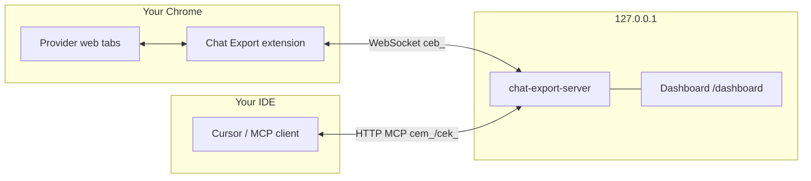

[English](README.md) | [Русский](README.ru.md) · 

# Chat Export — Chrome extension

Export and control your **web** chats on ChatGPT, Grok, X Grok, Claude, and GitHub Copilot — from your browser, under your rules. The extension adds an export bar on provider sites, downloads **Markdown, YAML, JSON, HTML, and PDF** locally, and connects to the optional [Chat Export MCP server](https://github.com/svergio/chat-export-server) so coding agents (Cursor and others) can list, export, create, and ask in those UIs **without vendor API keys**.

## The problem

Official UIs are great for chatting but weak for **archiving**, **batch export**, and **agent orchestration**. Copy-paste does not scale across five providers, and cloud APIs are a separate billing and compliance story.

## What you get

| Platform | Hosts | Export bar | MCP via server |
|----------|-------|------------|----------------|
| ChatGPT | `chatgpt.com` | Yes | Yes |
| Grok | `grok.com` | Yes | Yes |
| X Grok | `x.com/i/grok` | Yes | Yes |
| Claude | `claude.ai` | Yes | Yes |
| GitHub Copilot Chat | `github.com/copilot*` | Yes | Yes |

Dom parsing stays in the extension; automation and MCP live in the [local server](https://github.com/svergio/chat-export-server). Optional [dashboard](https://github.com/svergio/chat-export-dashboard) for operators.

## Quick start (3 steps)

1. **Load the extension** — `chrome://extensions` → Developer mode → **Load unpacked** → select this repo folder. Refresh each provider tab after reload.
2. **Start the server** (for MCP) — clone [chat-export-server](https://github.com/svergio/chat-export-server), `npm install && npm run build`, `chat-export-server key new`, `chat-export-server start` (default `http://127.0.0.1:8765`).
3. **Point your agent** — add MCP URL `http://127.0.0.1:8765/mcp` with `Authorization: Bearer <your key>` (see server README). Use `browsers_bind` so ops run in your logged-in profile.

Wiki walkthrough: [Installation and quickstart](https://github.com/svergio/chat-export-extension/wiki).

## Export bar (no server required)

1. Open [grok.com](https://grok.com), [chatgpt.com](https://chatgpt.com), [claude.ai](https://claude.ai), [x.com/i/grok](https://x.com/i/grok), or [github.com/copilot](https://github.com/copilot) and refresh after extension updates.
2. Choose formats (MD / YAML / JSON / HTML / PDF). Multi-format: **Folder** or **Zip** toggle.
3. Download icon — silent save to Downloads (Shift/Cmd = Save As). Names: `{platform}-{title}-{date}.{ext}`.

Markdown uses fenced role blocks; JSON includes `schema: chat-export/1`. PDF is selectable text (including Cyrillic), not a screenshot.

Platform rollout notes: [docs/platforms.md](docs/platforms.md) in the maintainer tree.

## Security

- Export and bridge run **only on your machine**. No analytics in the extension path described here.
- Only **your** logged-in sessions are touched; the server does not receive site passwords.
- Browser bridge uses `ceb_` tokens; MCP uses `cem_`/`cek_`. Do not commit keys. Rotate if leaked.
- Destructive automation (`chats_delete`, etc.) is **gated** in extension settings and on the server (`allowDestructive`, `confirm: true`).
- Threat model and audit expectations: server [SECURITY.md](https://github.com/svergio/chat-export-server/blob/main/SECURITY.md) and project [security audit](https://github.com/svergio/chat-export-server#security).

## Related repositories

| Repo | Role |
|------|------|
| [chat-export-extension](https://github.com/svergio/chat-export-extension) (this repo) | MV3 UI, content scripts, WS bridge |
| [chat-export-server](https://github.com/svergio/chat-export-server) | MCP, jobs, SQLite cache, hub |
| [chat-export-dashboard](https://github.com/svergio/chat-export-dashboard) | React operator UI (`/dashboard`) |
| [Wiki](https://github.com/svergio/chat-export-extension/wiki) | Install, tools, FAQ |

## Support the project

Chat Export is free and open source. If it saves you time:

- **Tip (fiat):** [DonationAlerts — svwergio_mel](https://www.donationalerts.com/r/svwergio_mel)
- **Crypto (optional):** maintainers document public addresses in [crypto-donations.md](https://github.com/svergio/chat-export-server/blob/main/README.md#support-the-project) — verify the network before sending.

Tips are voluntary and non-refundable. They do not buy private support SLAs.

## License

See [LICENSE](LICENSE) in this repository.
