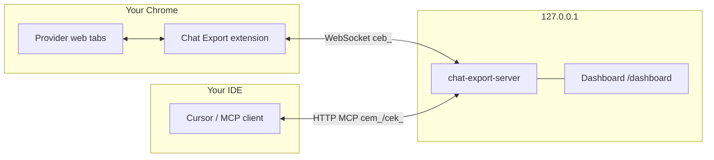

[English](README.md) | [Русский](README.ru.md) ·  · 

# Chat Export — Chrome extension

  

Export and control your **web** chats on eight providers (ChatGPT, Grok, X Grok, Claude, GitHub Copilot, Qwen, DeepSeek, Perplexity) — from your browser, under your rules. The extension adds an export bar on provider sites, downloads **Markdown, YAML, JSON, HTML, and PDF** locally, and connects to the optional [Chat Export MCP server](https://github.com/svergio/chat-export-server) so coding agents (Cursor and others) can list, export, create, and ask in those UIs **without vendor API keys**.

**Vs official ChatGPT export:** OpenAI’s data export is one zip of *all* chats as JSON after a request/wait cycle. This extension exports the *current* chat to Markdown or PDF (and YAML/JSON/HTML) in one click — no account dump, no waiting for a bulk archive. Same one-chat, local download pattern on the other seven providers.

**No network, no analytics, local-only.** Export and the optional MCP bridge stay on your machine (`chrome.downloads` + `127.0.0.1`). The extension does not phone home and does not include telemetry.

**Install zip:** [chat-export-extension-2.0.3.zip](https://github.com/svergio/chat-export-extension/releases/download/v2.0.3/chat-export-extension-2.0.3.zip) — unzip, then Chrome → Developer mode → **Load unpacked**. Release notes: [v2.0.3](https://github.com/svergio/chat-export-extension/releases/tag/v2.0.3).

## The problem

Official UIs are great for chatting but weak for **archiving**, **batch export**, and **agent orchestration**. Copy-paste does not scale across eight providers, and cloud APIs are a separate billing and compliance story.

## What you get

| Platform | Hosts | Export bar | MCP via server |
|----------|-------|------------|----------------|
| ChatGPT | `chatgpt.com` | Yes | Yes |
| Grok | `grok.com` | Yes | Yes |
| X Grok | `x.com/i/grok` | Yes | Yes |
| Claude | `claude.ai` | Yes | Yes |
| GitHub Copilot Chat | `github.com/copilot*` | Yes | Yes |
| Qwen | `chat.qwen.ai` | Yes | Yes |
| DeepSeek | `chat.deepseek.com` | Yes | Yes |
| Perplexity | `perplexity.ai` | Yes | Yes |

Dom parsing stays in the extension; automation and MCP live in the [local server](https://github.com/svergio/chat-export-server). Optional [dashboard](https://github.com/svergio/chat-export-dashboard) for operators.

## Quick start (3 steps)

1. **Load the extension** — `chrome://extensions` → Developer mode → **Load unpacked** → select this repo folder. Refresh each provider tab after reload.
2. **Start the server** (for MCP) — clone [chat-export-server](https://github.com/svergio/chat-export-server), `npm install && npm run build`, `chat-export-server key new`, `chat-export-server start` (default `http://127.0.0.1:8765`).
3. **Point your agent** — add MCP URL `http://127.0.0.1:8765/mcp` with `Authorization: Bearer <your key>` (see server README). Use `browsers_bind` so ops run in your logged-in profile.

Wiki walkthrough: [Installation and quickstart](https://github.com/svergio/chat-export-extension/wiki).

## Configuration

This repo controls the **browser bridge** only. MCP keys and the data directory live on [chat-export-server](https://github.com/svergio/chat-export-server).

### Popup and options (`src/settings.js`)

Settings persist in `chrome.storage.local` under `ce.settings`.

| Setting | Default | Role |
|---------|---------|------|
| `serverOn` | `false` | Turn WebSocket bridge on |
| `host` | `127.0.0.1` | Server host (keep loopback unless you know the risk) |
| `port` | `8765` | Server HTTP/WS port |
| `apiKey` | empty | Browser gateway token `ceb_…` from server or dashboard |
| `browserLabel` | `Chrome` | Label in dashboard / `browsers_list` |
| `platforms.*` | all enabled | Per-site toggles: `chatgpt`, `grok`, `grok-x`, `copilot`, `claude`, `qwen`, `deepseek`, `perplexity` |
| `allowCreate` | `true` | Allow MCP create/send |
| `allowDestructive` | `false` | Allow MCP delete (server must agree) |
| `allowProjects` | `true` | Project tools where supported |
| `rpcTimeoutS` | `60` | Extension RPC timeout (seconds) |

**Basic** mode: export formats and bridge on/off. **Advanced**: host, port, `ceb_` token, platform matrix, permission gates.

### Connect to the local server

1. Start [chat-export-server](https://github.com/svergio/chat-export-server) on `http://127.0.0.1:8765`.
2. Create or copy a **`ceb_`** token (`chat-export-server browser enroll` or dashboard **Browsers**).
3. Popup → Advanced → paste token, set host/port, enable **serverOn**, save.
4. Open provider tabs logged in; status should show a live WebSocket (`/ws`).

### Browser slots (two profiles)

Up to **two** Chrome profiles may hold active `ceb_` connections (separate job lanes). Install this extension in the second profile, enroll another `ceb_` key in the [dashboard](https://github.com/svergio/chat-export-dashboard) **Browsers** page, keep both windows open.

Server MCP setup: [server README — Configuration](https://github.com/svergio/chat-export-server#configuration). Dashboard login: [dashboard README](https://github.com/svergio/chat-export-dashboard#configuration).

## Export bar (no server required)

1. Open a supported host (e.g. [chatgpt.com](https://chatgpt.com), [grok.com](https://grok.com), [claude.ai](https://claude.ai), [chat.qwen.ai](https://chat.qwen.ai), [chat.deepseek.com](https://chat.deepseek.com), [perplexity.ai](https://perplexity.ai)) and refresh after extension updates.
2. Choose formats (MD / YAML / JSON / HTML / PDF). Multi-format: **Folder** or **Zip** toggle.
3. Download icon — silent save to Downloads (Shift/Cmd = Save As). Names: `{platform}-{title}-{date}.{ext}`.

Markdown uses fenced role blocks; JSON includes `schema: chat-export/1`. PDF is selectable text (including Cyrillic), not a screenshot.

Platform rollout notes: [docs/platforms.md](docs/platforms.md) in the maintainer tree.

## Security

- Export and bridge run **only on your machine**. No analytics in the extension path described here.
- Only **your** logged-in sessions are touched; the server does not receive site passwords.
- Browser bridge uses `ceb_` tokens; MCP uses `cem_`/`cek_`. Do not commit keys. Rotate if leaked.
- Destructive automation (`chats_delete`, etc.) is **gated** in extension settings and on the server (`allowDestructive`, `confirm: true`).
- Threat model and audit expectations: server [SECURITY.md](https://github.com/svergio/chat-export-server/blob/main/SECURITY.md) and project [security audit](https://github.com/svergio/chat-export-server#security).

## Honesty: ToS and fragility

**Provider ToS.** The optional MCP server drives provider web UIs the same way you would (tabs, clicks, DOM). That can conflict with some providers’ terms if you automate at scale. Chat Export keeps **create** and especially **delete** conservative by default: extension `allowDestructive` defaults to `false`, the server matches that, and delete still requires `confirm: true`. Treat those gates as a feature — turn them on only when you intend to automate writes.

**Fragility.** Export and automation read the live DOM (and sometimes in-page APIs). A provider UI redesign can break a content script overnight. Prefer filing [issues](https://github.com/svergio/chat-export-extension/issues); platform and locale checklists live in [CONTRIBUTING.md](CONTRIBUTING.md).

## Related repositories

| Repo | Role |
|------|------|
| [chat-export-extension](https://github.com/svergio/chat-export-extension) (this repo) | MV3 UI, content scripts, WS bridge |
| [chat-export-server](https://github.com/svergio/chat-export-server) | MCP, jobs, SQLite cache, hub |
| [chat-export-dashboard](https://github.com/svergio/chat-export-dashboard) | React operator UI (`/dashboard`) |
| [Wiki](https://github.com/svergio/chat-export-extension/wiki) | Install, tools, FAQ |

## Support the project

Chat Export is free and open source. If it saves you time:

- **Tip (fiat):** [DonationAlerts — svwergio_mel](https://www.donationalerts.com/r/svwergio_mel)

Tips are voluntary and non-refundable. They do not buy private support SLAs.

## Contributing

Platform and locale checklists (concrete paths across extension, server, dashboard): [CONTRIBUTING.md](CONTRIBUTING.md) and [wiki Contributing](https://github.com/svergio/chat-export-extension/wiki/Contributing).

## License

See [LICENSE](LICENSE) in this repository.
