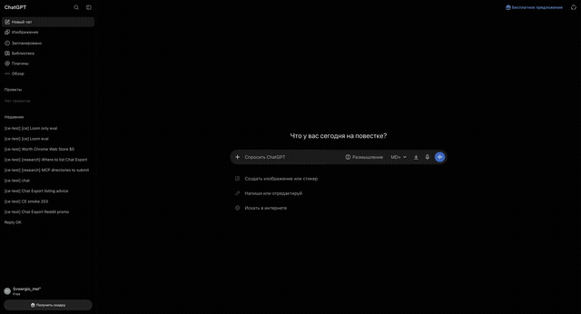

[English](README.md) | [Русский](README.ru.md) · [](https://www.donationalerts.com/r/svwergio_mel) · [](https://glama.ai/mcp/servers/svergio/chat-export-server) · [](https://mcpservers.org/ru/) · [](https://mcprush.com/to/chat-export-mcp?ref=badge)

# Chat Export — Chrome extension

<p align="center">
  
</p>

Export and control your **web** chats on **twelve** providers (ChatGPT, Grok, X Grok, Claude, GitHub Copilot, Qwen, DeepSeek, Perplexity, Kimi, Z.ai, MiniMax, JanitorAI) — from your browser, under your rules. The extension adds an export bar on provider sites, downloads **Markdown, YAML, JSON, HTML, and PDF** locally, and connects to the optional [Chat Export MCP server](https://github.com/svergio/chat-export-server) so agents in **Cursor**, **Claude Desktop**, and other MCP clients can list, export, create, and ask on **eleven** of those UIs (**JanitorAI** is extension export-bar only) **without vendor API keys**.

**Vs official ChatGPT export:** OpenAI’s data export is one zip of *all* chats as JSON after a request/wait cycle. This extension exports the *current* chat to Markdown or PDF (and YAML/JSON/HTML) in one click — no account dump, no waiting for a bulk archive. Same one-chat, local download pattern on the other eleven providers.

**No network, no analytics, local-only.** Export and the optional MCP bridge stay on your machine (`chrome.downloads` + `127.0.0.1`). The extension does not phone home and does not include telemetry.

## Standalone

Chat Export is a **full product** in three public repos (extension, server, dashboard). Manual export works with the extension alone. MCP automation uses `chat-export-server` and the **MV3 extension bridge** in your Chrome tabs — **not** Chrome DevTools MCP. Deploy the server **natively**, via **Docker / Colima**, or **Kubernetes**. You supply the MCP client — common choices include **Cursor** (Chrome extension + MCP; Cursor marketplace listing pending approval), **Claude Desktop** and Claude MCP integrations (submission in progress), and **LangChain**-based local agents. None are bundled with the product.

**Install zip:** [chat-export-extension-2.0.9.zip](https://github.com/svergio/chat-export-extension/releases/download/v2.0.9/chat-export-extension-2.0.9.zip) — unzip, then Chrome → Developer mode → **Load unpacked**. Release notes: [v2.0.9](https://github.com/svergio/chat-export-extension/releases/tag/v2.0.9).

## The problem

Official UIs are great for chatting but weak for **archiving**, **batch export**, and **agent orchestration**. Copy-paste does not scale across twelve providers, and cloud APIs are a separate billing and compliance story.

## What you get

| Platform | Hosts | Export bar | MCP via server |
|----------|-------|------------|----------------|
| ChatGPT | `chatgpt.com` | Yes | Yes |
| Grok | `grok.com` | Yes | Yes |
| X Grok | `x.com/i/grok` | Yes | Yes |
| Claude | `claude.ai` | Yes | Yes |
| GitHub Copilot Chat | `github.com/copilot*` | Yes | Yes |
| Qwen | `chat.qwen.ai` | Yes | Yes |
| DeepSeek | `chat.deepseek.com` | Yes | Yes |
| Perplexity | `perplexity.ai` | Yes | Yes |
| Kimi | `kimi.com`, `www.kimi.com` | Yes | Yes |
| Z.ai | `chat.z.ai` | Yes | Yes |
| MiniMax | `agent.minimax.io` | Yes | Yes |
| JanitorAI | `janitorai.com` | Yes | No (extension-only) |

Dom parsing stays in the extension; automation and MCP live in the [local server](https://github.com/svergio/chat-export-server). Optional [dashboard](https://github.com/svergio/chat-export-dashboard) for operators.

## How it fits together

Install the Chrome extension for one-click export from ChatGPT, Grok, Claude, and nine other web UIs — files land in your Downloads folder with no network calls. Turn on the **browser bridge** in the popup when you want a local agent to list, export, create, or ask inside those same logged-in tabs: the extension opens a WebSocket to **chat-export-server** on `127.0.0.1` (token prefix `ceb_`). Point any MCP client at `http://127.0.0.1:8765/mcp` with a `cem_`/`cek_` key. Optionally open the operator **dashboard** on the same host for queues, browsers, and token management.

Deploy the server **natively**, with **Docker / Colima**, or on **Kubernetes** — see the server README and wiki. Stack diagrams (Mermaid), data flow, and deploy surfaces: **[Wiki — Architecture](https://github.com/svergio/chat-export-extension/wiki/Architecture)**. Walkthroughs: [Installation and quickstart](https://github.com/svergio/chat-export-extension/wiki/Installation-and-Quickstart) · [Use cases](https://github.com/svergio/chat-export-extension/wiki/Use-Cases) · [Native / Docker / K8s](https://github.com/svergio/chat-export-extension/wiki/Native-and-Kubernetes-Deployment) · two-tier ToS in [LEGAL.md](LEGAL.md).

## Quick start (3 steps)

1. **Load the extension** — `chrome://extensions` → Developer mode → **Load unpacked** → select this repo folder. Refresh each provider tab after reload.
2. **Start the server** (for MCP) — clone [chat-export-server](https://github.com/svergio/chat-export-server), `npm install && npm run build`, `chat-export-server key new`, `chat-export-server start` (default `http://127.0.0.1:8765`).
3. **Point your agent** — add MCP URL `http://127.0.0.1:8765/mcp` with `Authorization: Bearer <your key>` (see server README). Use `browsers_bind` so ops run in your logged-in profile.

Wiki walkthrough: [Installation and quickstart](https://github.com/svergio/chat-export-extension/wiki).

## Configuration

This repo controls the **browser bridge** only. MCP keys and the data directory live on [chat-export-server](https://github.com/svergio/chat-export-server).

### Popup and options (`src/settings.js`)

Settings persist in `chrome.storage.local` under `ce.settings`.

| Setting | Default | Role |
|---------|---------|------|
| `serverOn` | `false` | Turn WebSocket bridge on |
| `host` | `127.0.0.1` | Server host (keep loopback unless you know the risk) |
| `port` | `8765` | Server HTTP/WS port |
| `apiKey` | empty | Browser gateway token `ceb_…` from server or dashboard |
| `browserLabel` | `Chrome` | Label in dashboard / `browsers_list` |
| `platforms.*` | all enabled | Per-site toggles: `chatgpt`, `grok`, `grok-x`, `copilot`, `claude`, `qwen`, `deepseek`, `perplexity`, `kimi`, `zai`, `minimax`, `janitorai` |
| `allowCreate` | `true` | Allow MCP create/send |
| `allowDestructive` | `false` | Allow MCP delete (server must agree) |
| `allowProjects` | `true` | Project tools where supported |
| `rpcTimeoutS` | `60` | Extension RPC timeout (seconds) |

**Basic** mode: export formats and bridge on/off. **Advanced**: host, port, `ceb_` token, platform matrix, permission gates.

### Connect to the local server

1. Start [chat-export-server](https://github.com/svergio/chat-export-server) on `http://127.0.0.1:8765`.
2. Create or copy a **`ceb_`** token (`chat-export-server browser enroll` or dashboard **Browsers**).
3. Popup → Advanced → paste token, set host/port, enable **serverOn**, save.
4. Open provider tabs logged in; status should show a live WebSocket (`/ws`).

### Browser slots (two profiles)

Up to **two** Chrome profiles may hold active `ceb_` connections (separate job lanes). Install this extension in the second profile, enroll another `ceb_` key in the [dashboard](https://github.com/svergio/chat-export-dashboard) **Browsers** page, keep both windows open.

Server MCP setup: [server README — Configuration](https://github.com/svergio/chat-export-server#configuration). Dashboard login: [dashboard README](https://github.com/svergio/chat-export-dashboard#configuration).

## Export bar (no server required)

1. Open a supported host (e.g. [chatgpt.com](https://chatgpt.com), [grok.com](https://grok.com), [claude.ai](https://claude.ai), [chat.qwen.ai](https://chat.qwen.ai), [chat.deepseek.com](https://chat.deepseek.com), [perplexity.ai](https://perplexity.ai), [kimi.com](https://www.kimi.com), [chat.z.ai](https://chat.z.ai), [agent.minimax.io](https://agent.minimax.io), [janitorai.com](https://janitorai.com)) and refresh after extension updates.
2. Choose formats (MD / YAML / JSON / HTML / PDF). **Folder** or **Zip** is always available (even for one format).
3. Download — after you pick a default folder once, saves are **silent** into that folder. **Shift+click** changes default folder (`rebind`) or asks once (`saveAs`); configure in popup **Export settings** (above Advanced). Wiki: [Saving and Shift modes](https://github.com/svergio/chat-export-extension/wiki/Saving-and-Shift-Modes) · [per-provider UI galleries](https://github.com/svergio/chat-export-extension/wiki/Supported-Platforms#provider-ui-galleries-screenshots--gif).

**What the files look like (semantics):** Default schema `chat-export/1` — Markdown `` ```md `` fences (`sys` / `user:` / `assistant:` / `sources`); JSON `schema: chat-export/1` with `messages[{ role, role_tag, text, … }]`. Optional `sharegpt/1` for ShareGPT-style `conversations[{ from, value }]`. Choose schema in the popup (Advanced); the page bar only picks formats. Hub + minis: **[Wiki — Export formats](https://github.com/svergio/chat-export-extension/wiki/Export-Formats)**.


Platform rollout notes: [docs/platforms.md](docs/platforms.md) in the maintainer tree.

## Security

- Export and bridge run **only on your machine**. No analytics in the extension path described here.
- Only **your** logged-in sessions are touched; the server does not receive site passwords.
- Browser bridge uses `ceb_` tokens; MCP uses `cem_`/`cek_`. Do not commit keys. Rotate if leaked.
- Destructive automation (`chats_delete`, etc.) is **gated** in extension settings and on the server (`allowDestructive`, `confirm: true`).
- Threat model and audit expectations: server [SECURITY.md](https://github.com/svergio/chat-export-server/blob/main/SECURITY.md) and project [security audit](https://github.com/svergio/chat-export-server#security).

## Honesty: ToS and fragility

**Two-tier Terms of Use ([LEGAL.md](LEGAL.md)).** Because Chat Export interacts with live web UIs and in-page APIs inside your logged-in session, the extension enforces a two-step local consent flow:
1. **Tier 1 (General Export Disclaimer)** on first popup open — explains that the software is provided "AS IS" under the MIT License and warns that automated DOM harvesting or internal API requests may violate provider Terms of Service or result in rate-limiting or account suspension.
2. **Tier 2 (Advanced Mode / Local MCP Gateway)** when opening `Advanced` — covers external agent automation via MCP clients such as **Cursor**, **Claude Desktop**, or a **local LLM agent** (e.g. LangChain MCP) connected to [chat-export-server](https://github.com/svergio/chat-export-server). Chat Export keeps **create** and especially **delete** conservative by default: extension `allowDestructive` defaults to `false`, the server matches that, and delete still requires `confirm: true`.

**Fragility.** Export and automation read the live DOM (and sometimes in-page APIs). A provider UI redesign can break a content script overnight. Prefer filing [issues](https://github.com/svergio/chat-export-extension/issues); platform and locale checklists live in [CONTRIBUTING.md](CONTRIBUTING.md).

## Related repositories

| Repo | Role |
|------|------|
| [chat-export-extension](https://github.com/svergio/chat-export-extension) (this repo) | MV3 UI, content scripts, WS bridge |
| [chat-export-server](https://github.com/svergio/chat-export-server) | MCP, jobs, SQLite cache, hub (listed on [MCP Servers](https://mcpservers.org/ru/), [Glama](https://glama.ai/mcp/servers/svergio/chat-export-server) & [Mcprush](https://mcprush.com/svergio/chat-export-mcp)) |
| [chat-export-dashboard](https://github.com/svergio/chat-export-dashboard) | React operator UI (`/dashboard`) |
| [Wiki](https://github.com/svergio/chat-export-extension/wiki) | Install, tools, FAQ |

## Support the project

Chat Export is free and open source. If it saves you time:

- **Tip (fiat):** [DonationAlerts — svwergio_mel](https://www.donationalerts.com/r/svwergio_mel)

Tips are voluntary and non-refundable. They do not buy private support SLAs.

## Contributing

Platform and locale checklists (concrete paths across extension, server, dashboard): [CONTRIBUTING.md](CONTRIBUTING.md) · [CONTRIBUTING.ru.md](CONTRIBUTING.ru.md) · [wiki Contributing](https://github.com/svergio/chat-export-extension/wiki/Contributing).

## Dependencies

| Layer | Stack |
| --- | --- |
| Extension (this repo) | Vanilla MV3 + **Preact** (bundled via esbuild); PDF helpers in `vendor/` |
| Optional server | [chat-export-server](https://github.com/svergio/chat-export-server) — Node 22, MCP SDK, `ws`, Zod, `@chat-export/protocol` |
| Optional dashboard | [chat-export-dashboard](https://github.com/svergio/chat-export-dashboard) — React 19 static UI at `/dashboard/` |

**Wire path:** extension ↔ server WebSocket (`/ws`, `ceb_` token) ↔ MCP (`/mcp`) ↔ dashboard (same host, `/dashboard/api`). Protocol schemas live in the server repo (`packages/protocol/`).

Third-party licenses: [THIRD_PARTY_NOTICES.md](./THIRD_PARTY_NOTICES.md). Regenerate after dependency bumps: `npm run licenses`.

**Optional MCP clients (not bundled):** [Cursor](https://cursor.com) · [Claude Desktop](https://claude.ai/download) · [LangChain](https://www.langchain.com/) and any Streamable HTTP MCP client pointed at `http://127.0.0.1:8765/mcp`. The extension runs standalone in Chrome without them.

Product family: the three public GitHub repos above. Documentation: [extension wiki](https://github.com/svergio/chat-export-extension/wiki) (use cases, [local LLM via LangChain](https://github.com/svergio/chat-export-extension/wiki/Local-LLM-Bonsai-27B-Guide)).

## License

See [LICENSE](LICENSE) in this repository.
