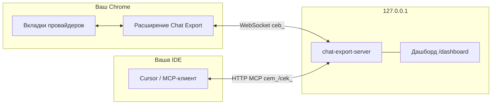

[English](README.md) | [Русский](README.ru.md) · 

# Chat Export — расширение Chrome

Экспорт и управление **веб-чатами** ChatGPT, Grok, X Grok, Claude и GitHub Copilot — в вашем браузере, под вашими правилами. Расширение добавляет панель экспорта на сайтах провайдеров, скачивает **Markdown, YAML, JSON, HTML и PDF** локально и подключается к [локальному MCP-серверу](https://github.com/svergio/chat-export-server), чтобы агенты (Cursor и др.) могли листать, экспортировать, создавать чаты и задавать вопросы **без API-ключей** вендоров.

## Проблема

Официальные интерфейсы удобны для диалога, но слабы для **архивации**, **пакетного экспорта** и **оркестрации агентами**. Копипаста не масштабируется на пять платформ; облачные API — отдельная оплата и комплаенс.

## Что вы получаете

| Платформа | Хосты | Панель экспорта | MCP через сервер |
|-----------|-------|-----------------|------------------|
| ChatGPT | `chatgpt.com` | Да | Да |
| Grok | `grok.com` | Да | Да |
| X Grok | `x.com/i/grok` | Да | Да |
| Claude | `claude.ai` | Да | Да |
| GitHub Copilot Chat | `github.com/copilot*` | Да | Да |

Разбор DOM — в расширении; автоматизация и MCP — в [локальном сервере](https://github.com/svergio/chat-export-server). Опционально — [дашборд](https://github.com/svergio/chat-export-dashboard).

## Быстрый старт (3 шага)

1. **Установите расширение** — `chrome://extensions` → режим разработчика → **Загрузить распакованное** → эта папка. Обновите вкладки провайдеров после перезагрузки расширения.
2. **Запустите сервер** (для MCP) — клонируйте [chat-export-server](https://github.com/svergio/chat-export-server), `npm install && npm run build`, `chat-export-server key new`, `chat-export-server start` (по умолчанию `http://127.0.0.1:8765`).
3. **Настройте агента** — MCP `http://127.0.0.1:8765/mcp`, заголовок `Authorization: Bearer <ключ>`. Вызовите `browsers_bind` для вашего профиля Chrome.

Подробнее в [вики](https://github.com/svergio/chat-export-extension/wiki).

## Панель экспорта (без сервера)

1. Откройте сайт провайдера и обновите вкладку после обновления расширения.
2. Выберите форматы (MD / YAML / JSON / HTML / PDF). При нескольких форматах — **Папка** или **Архив**.
3. Иконка загрузки — тихое сохранение в «Загрузки» (Shift/Cmd = «Сохранить как»). Имя: `{platform}-{title}-{date}.{ext}`.

## Безопасность

- Всё работает **только локально**. Без телеметрии в описанном контуре.
- Доступ только к **вашей** сессии; пароли сайтов сервер не получает.
- Мост браузера: `ceb_`; MCP: `cem_`/`cek_`. Не коммитьте ключи.
- Деструктивные операции выключены по умолчанию (`allowDestructive`, `confirm: true`).
- Модель угроз: [SECURITY.md](https://github.com/svergio/chat-export-server/blob/main/SECURITY.md) сервера.

## Соседние репозитории

| Репозиторий | Роль |
|-------------|------|
| [chat-export-extension](https://github.com/svergio/chat-export-extension) (этот) | MV3, content scripts, WS |
| [chat-export-server](https://github.com/svergio/chat-export-server) | MCP, очереди, кеш |
| [chat-export-dashboard](https://github.com/svergio/chat-export-dashboard) | Веб-UI оператора |
| [Wiki](https://github.com/svergio/chat-export-extension/wiki) | Установка, инструменты, FAQ |

## Поддержка проекта

Проект бесплатный и с открытым кодом:

- **Донат (фиат):** [DonationAlerts — svwergio_mel](https://www.donationalerts.com/r/svwergio_mel)
- **Крипто (по желанию):** публичные адреса — в разделе Support в README сервера; проверяйте сеть перед переводом.

Донаты добровольны и без возврата; не покупают приватную поддержку.

## Лицензия

См. [LICENSE](LICENSE).
