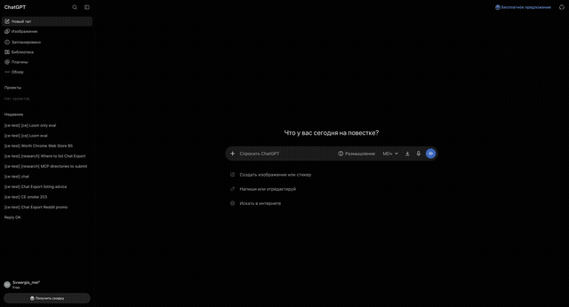
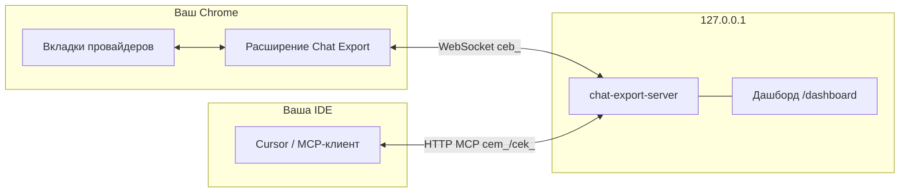

[English](README.md) | [Русский](README.ru.md) · 

# Chat Export — расширение Chrome

  

Экспорт и управление **веб-чатами** на восьми площадках (ChatGPT, Grok, X Grok, Claude, GitHub Copilot, Qwen, DeepSeek, Perplexity) — в вашем браузере, под вашими правилами. Расширение добавляет панель экспорта на сайтах провайдеров, скачивает **Markdown, YAML, JSON, HTML и PDF** локально и подключается к [локальному MCP-серверу](https://github.com/svergio/chat-export-server), чтобы агенты (Cursor и др.) могли листать, экспортировать, создавать чаты и задавать вопросы **без API-ключей** вендоров.

**Чем отличается от официального экспорта ChatGPT:** у OpenAI это один zip *всех* чатов в JSON после запроса и ожидания. Здесь — экспорт *текущего* чата в Markdown или PDF (и YAML/JSON/HTML) в один клик: без выгрузки всего аккаунта и без ожидания bulk-архива. Тот же локальный сценарий «один чат — один файл» на остальных семи площадках.

**Без сети, без аналитики, только локально.** Экспорт и опциональный MCP-мост остаются на вашей машине (`chrome.downloads` + `127.0.0.1`). Расширение не «звонит домой» и не содержит телеметрии.

**Zip для установки:** [chat-export-extension-2.0.1.zip](https://github.com/svergio/chat-export-extension/releases/download/v2.0.1/chat-export-extension-2.0.1.zip) — распакуйте, затем Chrome → режим разработчика → **Загрузить распакованное**. Релиз: [v2.0.1](https://github.com/svergio/chat-export-extension/releases/tag/v2.0.1).

## Проблема

Официальные интерфейсы удобны для диалога, но слабы для **архивации**, **пакетного экспорта** и **оркестрации агентами**. Копипаста не масштабируется на восемь платформ; облачные API — отдельная оплата и комплаенс.

## Что вы получаете

| Платформа | Хосты | Панель экспорта | MCP через сервер |
|-----------|-------|-----------------|------------------|
| ChatGPT | `chatgpt.com` | Да | Да |
| Grok | `grok.com` | Да | Да |
| X Grok | `x.com/i/grok` | Да | Да |
| Claude | `claude.ai` | Да | Да |
| GitHub Copilot Chat | `github.com/copilot*` | Да | Да |
| Qwen | `chat.qwen.ai` | Да | Да |
| DeepSeek | `chat.deepseek.com` | Да | Да |
| Perplexity | `perplexity.ai` | Да | Да |

Разбор DOM — в расширении; автоматизация и MCP — в [локальном сервере](https://github.com/svergio/chat-export-server). Опционально — [дашборд](https://github.com/svergio/chat-export-dashboard).

## Быстрый старт (3 шага)

1. **Установите расширение** — `chrome://extensions` → режим разработчика → **Загрузить распакованное** → эта папка. Обновите вкладки провайдеров после перезагрузки расширения.
2. **Запустите сервер** (для MCP) — клонируйте [chat-export-server](https://github.com/svergio/chat-export-server), `npm install && npm run build`, `chat-export-server key new`, `chat-export-server start` (по умолчанию `http://127.0.0.1:8765`).
3. **Настройте агента** — MCP `http://127.0.0.1:8765/mcp`, заголовок `Authorization: Bearer <ключ>`. Вызовите `browsers_bind` для вашего профиля Chrome.

Подробнее в [вики](https://github.com/svergio/chat-export-extension/wiki).

## Настройка

Мост браузера настраивается здесь; MCP-ключи и каталог данных — в [chat-export-server](https://github.com/svergio/chat-export-server).

### Попап и параметры (`src/settings.js`)

Хранение: `chrome.storage.local`, ключ `ce.settings`.

| Параметр | По умолчанию | Назначение |
|----------|--------------|------------|
| `serverOn` | `false` | Включить WebSocket-мост |
| `host` | `127.0.0.1` | Хост сервера |
| `port` | `8765` | Порт сервера |
| `apiKey` | пусто | Токен шлюза `ceb_…` с сервера или дашборда |
| `browserLabel` | `Chrome` | Подпись в дашборде / `browsers_list` |
| `platforms.*` | все вкл. | Платформы: `chatgpt`, `grok`, `grok-x`, `copilot`, `claude`, `qwen`, `deepseek`, `perplexity` |
| `allowCreate` | `true` | Создание/отправка через MCP |
| `allowDestructive` | `false` | Удаление (нужно и на сервере) |
| `allowProjects` | `true` | Инструменты проектов |
| `rpcTimeoutS` | `60` | Таймаут RPC (сек.) |

**Базовый** режим: форматы и мост. **Дополнительно**: хост, порт, `ceb_`, матрица платформ, права.

### Подключение к серверу

1. Запустите сервер на `http://127.0.0.1:8765`.
2. Получите **`ceb_`** (`chat-export-server browser enroll` или дашборд **Браузеры**).
3. Попап → Дополнительно → токен, хост, порт, включите мост.
4. Откройте вкладки провайдеров под своей учёткой.

### Два профиля Chrome

До **двух** профилей с отдельными `ceb_` и очередями. Второй профиль: то же расширение, новый `ceb_` в [дашборде](https://github.com/svergio/chat-export-dashboard).

MCP и `~/.chat-export`: [README сервера — Configuration](https://github.com/svergio/chat-export-server#configuration).

## Панель экспорта (без сервера)

1. Откройте сайт провайдера и обновите вкладку после обновления расширения.
2. Выберите форматы (MD / YAML / JSON / HTML / PDF). При нескольких форматах — **Папка** или **Архив**.
3. Иконка загрузки — тихое сохранение в «Загрузки» (Shift/Cmd = «Сохранить как»). Имя: `{platform}-{title}-{date}.{ext}`.

## Безопасность

- Всё работает **только локально**. Без телеметрии в описанном контуре.
- Доступ только к **вашей** сессии; пароли сайтов сервер не получает.
- Мост браузера: `ceb_`; MCP: `cem_`/`cek_`. Не коммитьте ключи.
- Деструктивные операции выключены по умолчанию (`allowDestructive`, `confirm: true`).
- Модель угроз: [SECURITY.md](https://github.com/svergio/chat-export-server/blob/main/SECURITY.md) сервера.

## Честно: ToS и хрупкость

**ToS провайдеров.** Опциональный MCP-сервер управляет веб-UI так же, как вы сами (вкладки, клики, DOM). Массовая автоматизация может расходиться с правилами некоторых сервисов. Chat Export держит **создание** и особенно **удаление** консервативно: `allowDestructive` в расширении по умолчанию `false`, сервер согласован, удаление всё равно требует `confirm: true`. Эти ограничения — фича: включайте только когда реально нужны записи в UI.

**Хрупкость.** Экспорт и автоматизация читают живой DOM (иногда in-page API). Редизайн сайта может сломать content script overnight. Пишите в [issues](https://github.com/svergio/chat-export-extension/issues); чеклисты платформ и локалей — в [CONTRIBUTING.md](CONTRIBUTING.md).

## Соседние репозитории

| Репозиторий | Роль |
|-------------|------|
| [chat-export-extension](https://github.com/svergio/chat-export-extension) (этот) | MV3, content scripts, WS |
| [chat-export-server](https://github.com/svergio/chat-export-server) | MCP, очереди, кеш |
| [chat-export-dashboard](https://github.com/svergio/chat-export-dashboard) | Веб-UI оператора |
| [Wiki](https://github.com/svergio/chat-export-extension/wiki) | Установка, инструменты, FAQ |

## Поддержка проекта

Проект бесплатный и с открытым кодом:

- **Донат (фиат):** [DonationAlerts — svwergio_mel](https://www.donationalerts.com/r/svwergio_mel)

Донаты добровольны и без возврата; не покупают приватную поддержку.

## Участие в разработке

Новые платформы и языки UI: [CONTRIBUTING.md](CONTRIBUTING.md), [вики](https://github.com/svergio/chat-export-extension/wiki/Contributing-RU).

## Лицензия

См. [LICENSE](LICENSE).
